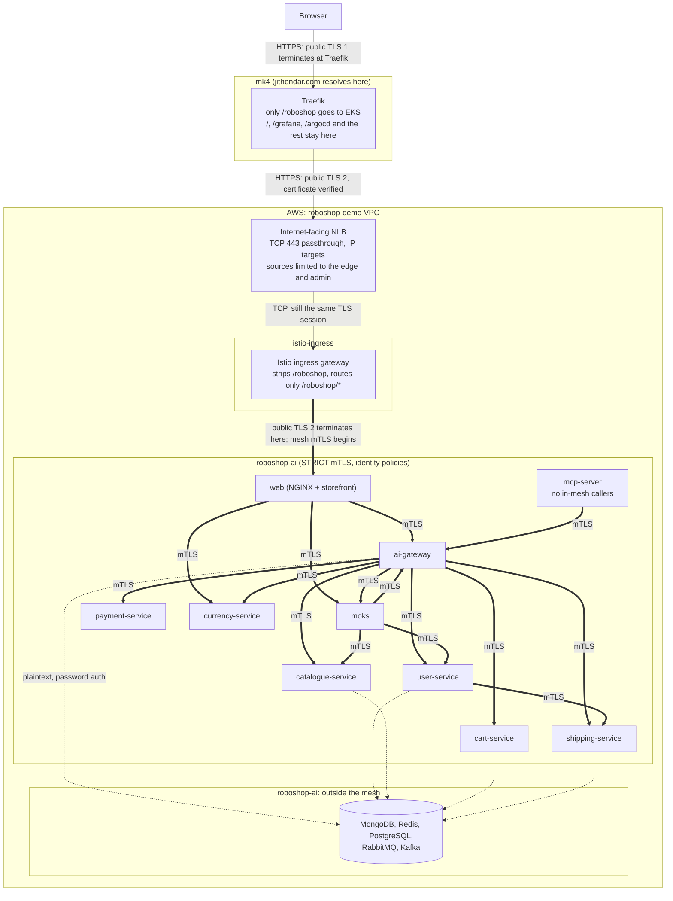

# EKS: RoboShop at https://jithendar.com/roboshop

The `roboshop-demo` EKS cluster and how public traffic reaches it: AWS Load Balancer Controller, Istio ingress and sidecar
mesh mTLS. Argo CD on mk4 manages this cluster as a remote cluster; register it once with
`argocd cluster add roboshop-demo --name roboshop-demo --yes`.

**Status: not tested on EKS.** Everything here has been validated offline only ([what ran](#validation)). Nothing is
deployed until you follow [RUNBOOK.md](RUNBOOK.md), and the steps there are the first real run.

These Applications live here rather than in `argocd/` because `scripts/argocd/deploy.py` only deploys to the local cluster.
Like the mk4 Applications, they do not sync automatically and must never be synced with prune.

## Layout

| Path | Contents | Applied by |
|---|---|---|
| `../infrastructure/eks-ingress.tf`, `eks-roles.tf` | AWS Load Balancer Controller, its IAM role and Pod Identity, Istio base, istiod, ingress gateway and the NLB Service | Terraform, once `eks_ingress_enabled = true` |
| `roboshop-demo/ingress/` | Certificate, Gateway, VirtualService | Argo CD: `roboshop-demo-ingress` |
| `roboshop-demo/mesh/` | ServiceAccounts, PeerAuthentication, AuthorizationPolicies | Argo CD: `roboshop-demo-mesh` |
| `edge/` | On **mk4**: the Traefik route that sends `/roboshop` to the NLB | Argo CD: `roboshop-demo-edge`; syncing it is the cutover |
| `roboshop-ai-catalog.patch` | The change to `roboshop-ai/argocd-eks`, which owns the workloads | `git apply` in roboshop-ai ([why](#the-roboshop-ai-patch)) |
| `diagrams/roboshop-ingress.mmd` | Editable source of the diagram below | |

Controllers are Terraform `helm_release`s like the other EKS add-ons here, so Argo CD never manages what it depends on.
Each resource has one owner. Minikube is unchanged: its Applications select files with `directory.include` and ignore the
new `kustomization.yaml` files, and the namespace label and ServiceAccounts exist only on EKS.

## Why the browser does not reach the NLB directly

Inspected on 2026-10-31: `jithendar.com` is a DNS-only Cloudflare A record for `46.224.38.14`, which is mk4. Traefik there
terminates TLS and routes by path: the Next.js site, `/grafana`, `/argocd`, `/prometheus` and `/roboshop` all share that
hostname. An NLB works at TCP level and cannot route by path, and a DNS record cannot name a path. Pointing the apex at the
NLB would take the whole website with it.

This repository controls Traefik, so the path routing stays there and only `/roboshop` moves. That differs from the
default `Browser → NLB` in one way: **the browser's TLS session ends at Traefik on mk4**, and Traefik opens a second,
verified TLS session to the Istio gateway through the NLB. Only the two addresses in `eks_ingress_source_cidrs` can reach
the NLB. If the apex ever moves to AWS, the browser would reach the NLB directly and nothing in EKS changes, but the
website needs a new home first, and `eks_ingress_source_cidrs` and port 80 would need revisiting.

The only external change is one DNS record for a **hostname**: `roboshop-origin.jithendar.com`, a DNS-only CNAME to the NLB.
It keeps the generated load balancer name out of Git. The apex and `www` records are not touched.



## Ingress

**NLB.** Internet-facing, IP targets (gateway pods registered directly), TCP passthrough on 443. Set in
`infrastructure/eks-ingress.tf`:

| Setting | Why |
|---|---|
| `spec.loadBalancerClass: service.k8s.aws/nlb` | Hands the Service to the controller. Its Service webhook is off, so nothing else is picked up. |
| `aws-load-balancer-scheme: internet-facing` | The default is `internal`, which mk4 could not reach. |
| `aws-load-balancer-nlb-target-type: ip` | The default is `instance`. No NodePorts, so `allocateLoadBalancerNodePorts: false`. |
| `aws-load-balancer-subnets` | The two public subnets from Terraform, explicit rather than discovered. |
| `aws-load-balancer-name` | A stable name for `aws elbv2` commands. It has no effect if changed after creation. |
| `spec.loadBalancerSourceRanges` | Inbound rules on the frontend security group the controller creates. The controller source confirms this applies with IP targets, despite the docs' note about client IP preservation. |
| `aws-load-balancer-healthcheck-*` | HTTP `15021 /healthz/ready`, Envoy's readiness. 15021 is not a Service port, so it is no listener; the controller adds a backend rule for the health check only. |
| `aws-load-balancer-attributes: load_balancing.cross_zone.enabled=true` | Both gateway pods serve either AZ. |
| `aws-load-balancer-target-group-attributes` | 30 s deregistration, shorter than the default 300 s; client IP preservation stays off for this path. |
| no `aws-load-balancer-ssl-cert` | The NLB never holds a certificate. |

The readiness gate is injected by selecting `istio-ingress` by name in `webhookNamespaceSelectors`, so a gateway rollout waits
until the new pod passes NLB health checks. Gateway: 2 to 3 replicas, spread across nodes, PDB `minAvailable: 1`. istiod: 2
replicas, since injection fails closed. No ALB, no second proxy. Application metrics stay private: they have no route, and
NGINX answers `/metrics` with 404.

**The `/roboshop` boundary.** There is exactly one rewrite, in `roboshop-demo/ingress/roboshop-virtualservice.yaml`:

| Hop | Path | Behaviour |
|---|---|---|
| Browser → Traefik | `/roboshop/products/x?a=1` | Routed only for `Path(/roboshop)` or `PathPrefix(/roboshop/)`. No stripPrefix. |
| Traefik → gateway | `/roboshop/products/x?a=1` | Unchanged, `Host: jithendar.com` kept. |
| Gateway → web | `/products/x?a=1` | **The prefix is stripped here.** `/roboshop` alone gets a 308 to `/roboshop/`, keeping the query. |
| web | `/products/x?a=1` | Same as behind Traefik on mk4: `FRONTEND_BASE_PATH=/roboshop` only rewrites HTML attributes. |

Nothing in the web image changes. Assets and API calls resolve from the module URL (`paths.ts`), there is no SPA catch-all
(NGINX maps each URL to a file, so refreshes work), and uploads keep NGINX's 2 MiB limit. Cookies are `Path=/; Secure;
HttpOnly; SameSite=Strict`, so they keep working, but as on mk4 the browser also sends them to the rest of `jithendar.com`.
Public and private API boundaries stay in NGINX: `/api/chat` is 403, `/metrics` is 404, and `mcp-server` has no route.

**Moks does not stream.** `/moks/chat` returns one JSON response after up to 26 s, and the gateway has no event-stream
code. So nothing here truncates it, on purpose: the VirtualService has no timeout, Traefik's response-header timeout is 0
and it flushes streamed responses, and the NLB idle timeout is 350 s. NGINX is the real limit, at 30 s for `/moks/*` and 35 s
for `/api/*`. `/api/*` has `proxy_buffering off`, but the `/moks/*` locations do not: if Moks ever streams, those need it too,
which is a change to the web image.

## TLS and mTLS are separate

| | Public TLS | Mesh mTLS |
|---|---|---|
| Protects | Browser to Traefik, and Traefik to gateway | Pod to pod inside `roboshop-ai` |
| Certificates | Let's Encrypt for `jithendar.com`, from cert-manager | Short-lived workload certificates from istiod, rotated automatically |
| Proves | The server is `jithendar.com` | The caller is workload X; both sides are authenticated |

Neither replaces the other, and neither replaces user login.

**Certificate.** `letsencrypt-prod` already exists on EKS from `infrastructure/eks-letsencrypt.tf`. It uses DNS-01 through
Cloudflare because Let's Encrypt cannot reach this cluster over HTTP. cert-manager writes `jithendar-com-tls` into
`istio-ingress`, where `credentialName` looks it up, and renews 30 days before expiry; the gateway reloads it without a
restart, and Traefik simply verifies the new one. The Cloudflare token is the only credential, and it is created by hand in
`cert-manager`, never in Git. **It is missing today**, so both issuers report `Ready=False`. The mk4 certificate is
independent. Both clusters count toward Let's Encrypt's limit of 5 duplicate certificates a week.

**Plaintext that remains.** Not every connection is encrypted:

| Hop | State |
|---|---|
| Inside a pod, sidecar to application | Plaintext on loopback, by design. |
| Applications to MongoDB, Redis, PostgreSQL, RabbitMQ | **Plaintext** in the VPC, with password auth. These stay out of the mesh, as in `deploy/eks`: single-replica demo stores, and the images start as root. Auto mTLS sends plaintext to them, so `STRICT` does not break them. |
| kafka-bridge to RabbitMQ, Kafka internal | **Plaintext**, same pod and stores. |
| Kubelet to pods | HTTP probes, answered by the sidecar's agent. |
| Traces | `OTEL_EXPORTER_OTLP_TRACES_ENDPOINT` names a collector that does not exist on EKS; export fails silently. |

The stores also have no network-level isolation: the VPC CNI add-on here does not enforce NetworkPolicy, and
`mcp-server-clients` has no effect on EKS. Any pod in the cluster can attempt a connection to them; the password is the only
barrier.

## Service communication matrix

Built from the service code and manifests (`USER_URL` and friends, `self.urls`, `upstream()`, NGINX `proxy_pass`). `tests/test_eks_ingress.py` asserts the policies match it exactly.

| Destination | Port | Allowed callers | Evidence |
|---|---|---|---|
| web | 8080 | istio-ingressgateway | Only entry point |
| ai-gateway | 3000 | web, moks, mcp-server | `proxy.conf`; `widget.py` `CHAT_URL`, `AUTH_URL`; `server.py` `/internal/llm/config`; `gateway_client.py` |
| user-service | 4109 | ai-gateway, moks | `user_client.py`; `widget.py` `HEALTH_URLS` |
| catalogue-service | 4108 | ai-gateway, moks | `self.urls`; `moks/server.py` |
| cart-service | 4107 | ai-gateway | `cart_repository.py` |
| payment-service | 4105 | ai-gateway | `self.urls["payment"]` |
| shipping-service | 4106 | ai-gateway, user-service | `self.urls`; `user-service/server.py` |
| currency-service | 4111 | ai-gateway, web | `currency_quote.py`; `routes.conf` |
| moks | 4103 | web, ai-gateway | `routes.conf`; `self.urls["agent"]` |
| mcp-server | 4107 | none | No in-mesh caller; use `kubectl port-forward`. `allow-nothing` denies the rest. |

Each workload has its own ServiceAccount, so its identity is `spiffe://cluster.local/ns/roboshop-ai/sa/<name>`. Probes are
rewritten by the sidecar and never pass through these policies. Application sessions, roles and service tokens stay in
place: a policy says which workload may call, not which person.

**`ai-gateway` is declared as TCP.** NGINX forwards the browser's `Host: jithendar.com`. A sidecar treating that port as
HTTP routes by Host, finds no such Service and sends the request through plaintext passthrough, which `STRICT` rejects. With
`appProtocol: tcp`, the sidecar routes by destination address instead and mTLS applies. The cost is no L7 metrics on that hop,
and policies on it can only use identities and ports, which is all they do.

**Client IPs.** `TRUSTED_PROXY_CIDRS` is unset, so ai-gateway rate limits see one peer. That is true on mk4 too, where it is the
web pod; here it is the sidecar's `127.0.0.6`. All visitors share the 300 per minute and AI limits on both clusters.
Fixing it takes a change to the web image. Nothing in the services treats loopback as trusted, so sidecars do not widen access.

## The roboshop-ai patch

Istio identity comes from the pod's ServiceAccount, and enrollment needs a namespace label, but `roboshop-ai/argocd-eks` owns
those Deployments and the Namespace. This work was scoped to tools, so that repository is untouched and the change ships
as `roboshop-ai-catalog.patch`, against commit `391b441`. It follows the repository's pattern: a `kustomization.yaml` used only
by argocd-eks, plus inline patches in each Application. It:

- sets `serviceAccountName` on the 10 application Deployments;
- adds `sidecar.istio.io/inject: "false"` to Redis, RabbitMQ, PostgreSQL, Kafka and the location import Job (MongoDB already has it);
- declares the `ai-gateway` Service port as TCP;
- labels the Namespace `istio-injection=enabled`, through the same Application that owns it.

Argo CD's `managedNamespaceMetadata` looks simpler but is the wrong tool here: it forces
`sync-options: ServerSideApply=true` onto the Namespace, overwriting the `Prune=false,Delete=false` annotation that protects it.

## Versions

Checked 2026-10-31 against the Istio support table, the Helm repositories and GitHub releases.

| Component | Pinned | Where | Compatibility |
|---|---|---|---|
| Amazon EKS | 1.36 | `eks_version` | Running version |
| AWS Load Balancer Controller | 3.6.2 (chart 3.6.2) | `eks-ingress.tf` | Latest release. IAM policy is the unmodified upstream `docs/install/iam_policy.json` of that tag, sha256 `16f232c9...a6a`. It covers ALB features this does not use; they are off with `enableShield/Waf/Wafv2=false`. |
| Istio base, istiod, gateway | 1.30.7 | `eks-ingress.tf` `istio_version` | Supports Kubernetes 1.32-1.36. **End of life ~December 2026.** 1.31.3 is released and supports 1.32-1.37, but its charts are in neither the Helm repository nor the OCI registry yet. Move when they are. |
| cert-manager | EKS add-on, AWS default for 1.36 | `eks-addons.tf` | Existing |
| Traefik | chart 42.0.0, v3.7.14 | `minikube/deploy-traefik.sh` | `ServersTransport` and `IngressRoute` CRDs confirmed on mk4 |
| Argo CD | v3.5.5 | mk4 | `Application` kustomize patches already in use |
| Terraform | 1.16.6 | workflows | Helm provider ~> 3.0, AWS provider ~> 6.0 |

Istio CNI is not used: pods get a short-lived `istio-init` with `NET_ADMIN`, which avoids a privileged DaemonSet on a two-node
cluster. Gateway API CRDs are not installed; this uses Istio's own Gateway and VirtualService, as `deploy/eks` does.

Capacity, from rendered requests: about 2.85 vCPU and 5.1 GiB, including the existing add-ons and 10 sidecars, against 3.86 vCPU
and 14 GiB on two `t4g.large` nodes. That fits, with little room for the gateway's third replica during a node replacement.

## Validation

Run from this repository with the roboshop-ai checkout alongside. None of it needs AWS.

```bash
terraform -chdir=infrastructure fmt -check -recursive
terraform -chdir=infrastructure validate
terraform -chdir=infrastructure test          # mock providers
python3 -m pytest -q tests/test_eks_ingress.py tests/test_yaml_layout.py
```

`tests/test_eks_ingress.py` also drives the real `services/web` NGINX templates through the route table, and needs `nginx`,
`envsubst` and a built `services/web/frontend/dist`; otherwise those cases skip.

```bash
kubectl kustomize eks/roboshop-demo/ingress > /tmp/ingress.yaml
kubectl kustomize eks/roboshop-demo/mesh > /tmp/mesh.yaml
kubeconform -strict -kubernetes-version master -schema-location default \
  -schema-location 'https://raw.githubusercontent.com/datreeio/CRDs-catalog/main/{{.Group}}/{{.ResourceKind}}_{{.ResourceAPIVersion}}.json' \
  /tmp/ingress.yaml /tmp/mesh.yaml
istioctl analyze --use-kube=false -A /tmp/ingress.yaml /tmp/mesh.yaml   # istioctl 1.30.7
```

Offline `istioctl analyze` catches invalid fields and missing Gateways. It does **not** catch a wrong destination host, a
missing Secret or a selector that matches nothing, which is why the pytest file checks those.
